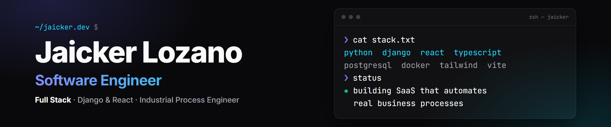

# 👋 Hi! I'm Jaicker Lozano

**Software Engineer** focused on full stack development (Django · React · TypeScript) and **Industrial Process Engineer** based in Chile 🇨🇱.
I build software that solves real business problems — from e-commerce to financial back-office automation — combining an engineer's process mindset with **AI-driven development** (agents & sub-agents) to ship clean, tested, maintainable code.

---

## 🚀 Currently building

Private SaaS products in active development for real clients. Source code is private; happy to walk through the architecture in an interview.

- 🛒 **E-commerce SaaS** — 🚧 *In development*
  Online store platform for Chilean businesses: product catalog, cart, shipping, checkout and order tracking.
  `Django REST Framework` · `React` · `TypeScript` · `Vite` · `Tailwind CSS` · `PostgreSQL` · `Docker`

- 🏦 **Bank Reconciliation SaaS** — 🚧 *In development*
  Automates monthly bank reconciliations for property management companies: parses bank statements from Chilean banks, matches transactions against accounting records and generates PDF/Excel reports.
  `Django` · `React` · `TypeScript` · `PostgreSQL` · `Docker`

---

## 💼 Featured Projects

- 📦 **Inventory System** — Full-stack inventory management with Django REST Framework + React/TypeScript. Real-time stock tracking, 3-level alert system, row-level concurrency protection (`select_for_update`) and Swagger API docs.
  👉 [Repository](https://github.com/jaickerlozano/inventory_sistem_full_stack) · [Live Demo](https://inventory-sistem-frontend.onrender.com/)

- 🏢 **Booking Manager** — Space reservation system for residential complexes. Role-based access (Admin/Resident), real-time AJAX search, email notifications, Cloudinary integration, deployed on Render with PostgreSQL.
  👉 [Repository](https://github.com/jaickerlozano/booking_manager_django) · [Live Demo](https://booking-manager-django.onrender.com/)

- 💻 **Personal Portfolio** — My portfolio with all the projects I've built.
  👉 [Repository](https://github.com/jaickerlozano/portfolio-jaicker) · [Live Demo](https://jaicker.dev)

📚 More projects (learning path)

- 🥤 [Vending Services Web App](https://github.com/jaickerlozano/vending-services-web-app) — Collaborative project: built the full Django REST backend, integrated it with the React frontend and added 78 automated tests.
- 📸 [Instagram Clone](https://github.com/jaickerlozano/instagram-django) — Django social network with auth, media handling and complex model relationships.
- 📚 [Library Management System](https://github.com/jaickerlozano/django-library-management-system) — Class-Based Views, custom ModelForms and a customized Django Admin.
- ⚙️ [Django Mastery Hub](https://github.com/jaickerlozano/conquer-blocks-django) — Django architectures, CBVs and backend structure.
- 🧪 [Rick & Morty Explorer](https://rickandmorty-api-react-iota.vercel.app) — React SPA with advanced filtering and persistence.
- ✏️ [Editor-TS](https://github.com/jaickerlozano/editor-ts) — Text editor in strict TypeScript with modular DOM manipulation.
- 🔢 [Sudoku Solver](https://jaickerlozano.github.io/sudoku-solver-reactjs) — Real-time Sudoku validation and solving in React.

---

## 💻 Tech Stack

**Backend:**    

**Frontend:**     

**Tools & Workflow:**    

---

## 🧭 How I work

- 🧱 **Clean architecture & testing** — maintainable structure and tests alongside the code.
- 🤖 **AI-driven development** — I direct AI agents for exploration, implementation and review; the engineering decisions stay mine.
- ⚙️ **Process mindset** — I start from the business process, then design the software around it.

---

## 🌟 Connect with me

